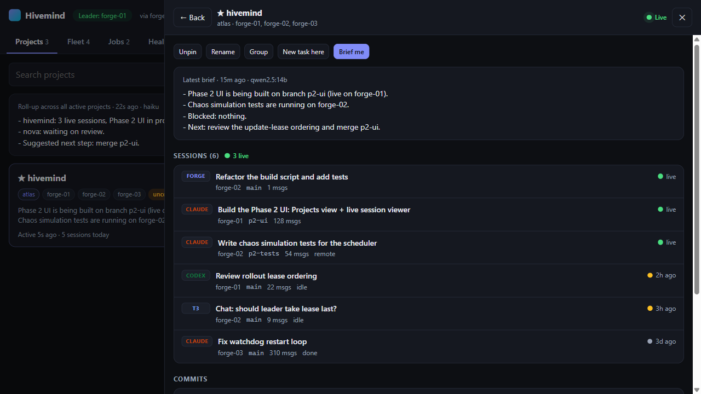
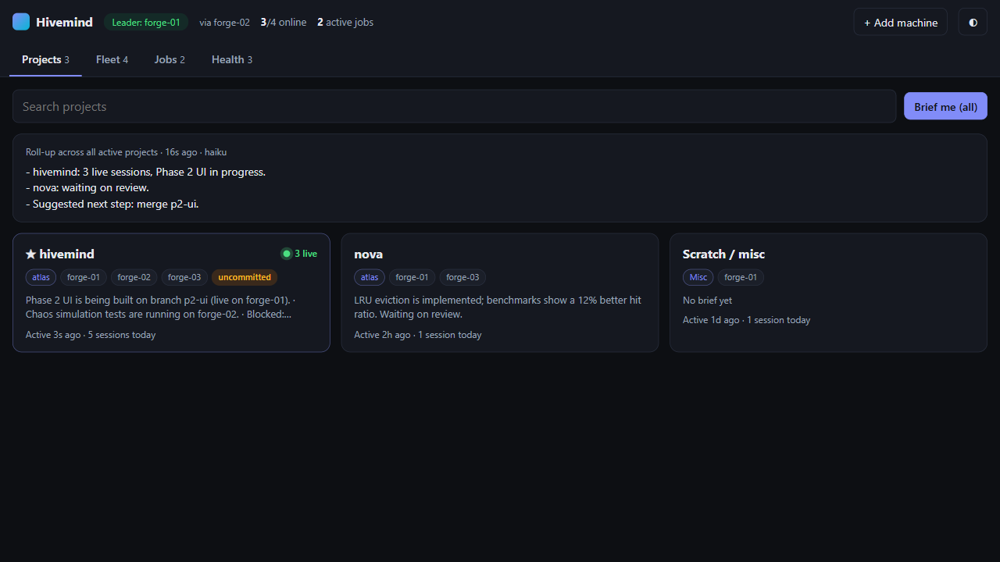
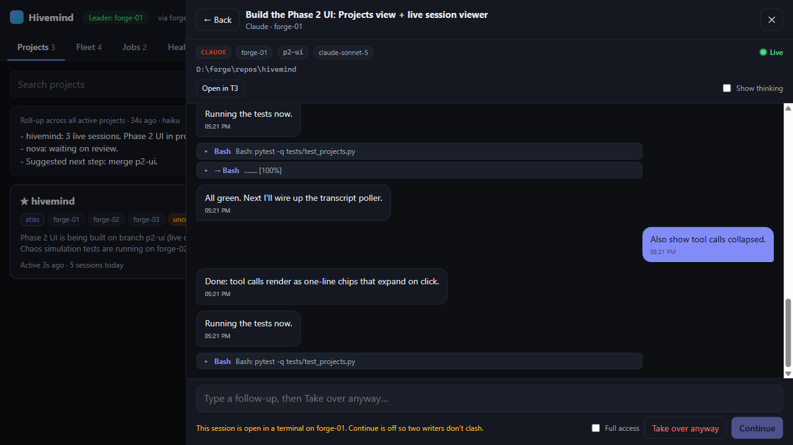
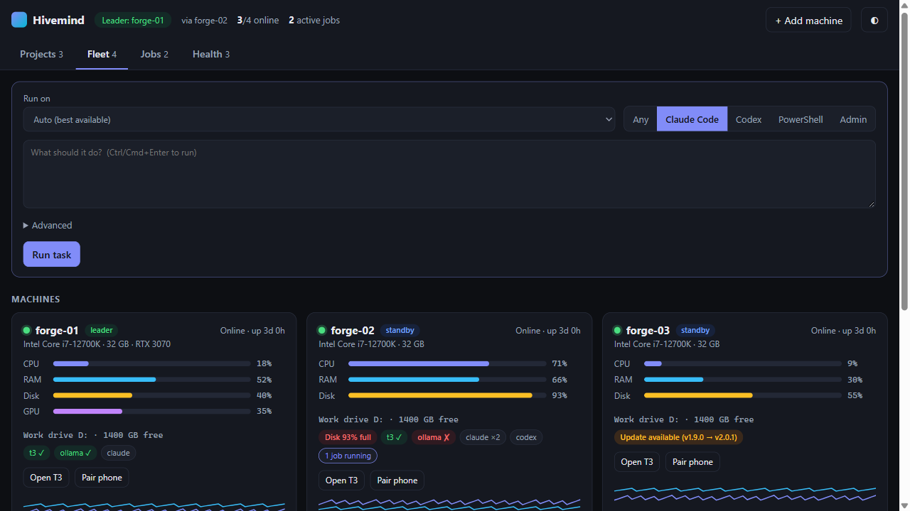
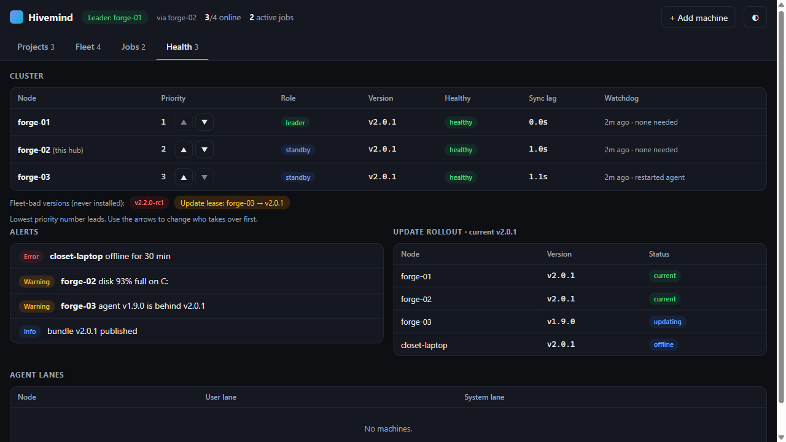
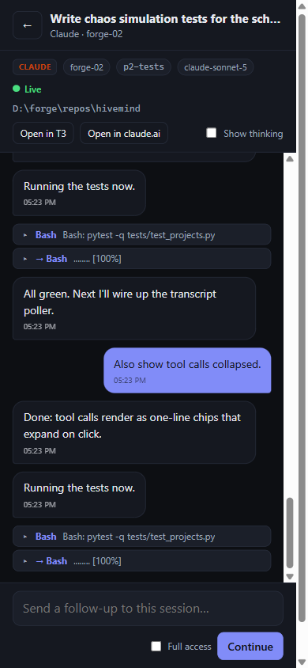
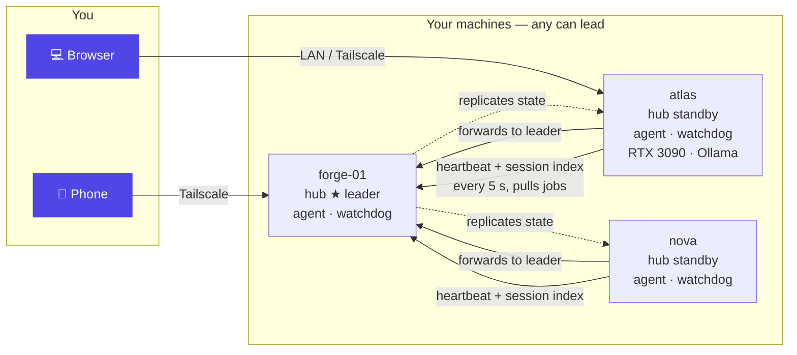

<div align="center">

# 🐝 Hivemind

### Every computer you own, one AI engineering team.

Hivemind turns the laptops, desktops and closet machines you already have into a **self-healing fleet**
that runs **Claude Code**, **Codex** and local models for you — and gives you one place
(desktop *or* phone) to see every project, every live agent session, and every machine.




</div>

---

## Why

You have more compute than you use. A gaming PC with a 3090 idling, an old laptop in a closet, the
machine on your desk. Meanwhile your AI agents are stuck in one terminal on one box, and you lose track
of which session on which machine was doing what.

**Hivemind is the missing control plane.** Install it once per machine; after that it:

- 🧠 **Groups every agent session into projects** — Claude Code, Codex, T3 Code threads and Hivemind
  jobs, across all machines, merged by git repo. Open a project, see what's running, what changed,
  and an AI-written brief of where things stand.
- 👀 **Shows live sessions as a chat** — watch an agent think and work in real time from your phone,
  then **continue** the conversation (or take it over) from anywhere.
- 🚀 **Runs work anywhere** — send a task to a specific machine or to **Auto**, which picks the
  least-busy capable box. Claude Code, Codex, PowerShell, local Ollama models, or a SYSTEM-level admin lane.
- 🩺 **Heals itself** — every machine runs the hub; one leads, the rest stand by with a replicated copy.
  Kill the leader and another takes over. A SYSTEM watchdog restarts anything that dies.
- 🔁 **Updates itself** — publish a release once; it rolls through the fleet one machine at a time,
  health-checked, with automatic rollback and a fleet-wide "bad version" list.
- 📱 **Works from your phone** — over Tailscale, no ports opened on your router.

<table>
<tr>
<td width="50%"><br><sub><b>Projects</b> — every repo you're working on, live session counts, AI brief excerpts</sub></td>
<td width="50%"><br><sub><b>Live session</b> — a Claude Code session streaming in as chat, tool calls collapsed</sub></td>
</tr>
<tr>
<td><br><sub><b>Fleet</b> — one composer for the whole fleet; CPU/RAM/GPU/disk, services, roles</sub></td>
<td><br><sub><b>Health</b> — leader election, sync lag, watchdog actions, rollout, alerts</sub></td>
</tr>
</table>

<p align="center"><br><sub>Same thing on your phone.</sub></p>

> Screenshots use demo data (`MOCK_DEMO=1 python tools/mock_ui_server.py`). Projects and live sessions are
> live as of **v2.2**; the "Today" home screen and Hive land in v2.3 / v2.4 — see [status](#-status).

---

## How it works



**Every machine runs the same four pieces** (installed to `C:\ProgramData\Forge`):

| Piece | Runs as | Job |
|---|---|---|
| **Hub** (`ForgeHub`) | you, at boot (S4U — no password stored, no login needed) | FastAPI + SQLite. Leader or standby. Serves the UI on `:8787`; standbys forward everything to the leader. |
| **Agent** (`ForgeAgent`) | you, at boot | Reports metrics, processes, logs and the **session index** every 5 s; **pulls** jobs and runs them with *your* Claude Code / Codex logins; keeps T3 Code and Ollama alive. |
| **Admin lane** (`ForgeSystemAgent`) | SYSTEM | Runs only allowlisted maintenance actions (winget, restart service, reboot…) or explicitly confirmed admin PowerShell. No more UAC prompts after install. |
| **Watchdog** (`ForgeWatchdog`) | SYSTEM, every minute | Restarts anything unhealthy (incl. zombie processes), installs newer releases when it holds the **update lease**, rolls back bad ones. |

**Design rules that keep it boring (in a good way):**
- **Pull, don't push.** Agents ask the hub for work; machines never need inbound access for jobs. No SSH.
- **Deterministic leadership.** Lowest priority number among healthy, synced hubs leads. No consensus library.
- **One release, everywhere.** The hub, agent, watchdog and UI ship as one versioned, sha256-verified bundle.
- **Metadata out, transcripts on demand.** The hub stores session titles/timestamps/repos; full
  transcripts stream from the owning machine only while you're looking (with secret redaction).
- **Accounts are the real limit.** Claude/Codex limits are per *account*, not per machine, so the
  scheduler tracks cooldowns fleet-wide and rotates engines (Claude → Codex → local model).

---

## Quick start

> **Alpha. Windows 10/11 only.** Requires Python 3.10+ and admin rights **once per machine**.
> Each machine uses its own `claude` / `codex` sign-in.

**1 · First machine (becomes the leader)**

```powershell
git clone https://github.com/CosmonautJones/hivemind; cd hivemind
.\tools\build-bundle.ps1 -OutDir .\dist          # -> dist\forge-<ver>.zip + .sha256
# write a bootstrap file with fresh random tokens (see NODE-README.md for the shape), then as admin:
.\agent\install.ps1 -BootstrapFile .\bootstrap.json -BundleFile .\dist\forge-<ver>.zip
```

Open **http://localhost:8787** and sign in with the `ui_token` from `C:\ProgramData\Forge\data\config.json`.

**2 · Every other machine** — click **+ Add machine** in the dashboard, copy the one-liner, run it in an
**admin** PowerShell on the new machine. It joins the cluster, becomes a standby hub, and shows up in ~30 s.

**3 · From your phone** — install [Tailscale](https://tailscale.com) on the machines and the phone, open
`http://<any-machine>:8787`, *Add to Home Screen*.

**Shipping changes** — bump `VERSION`, run the tests, then:

```powershell
.\tools\build-bundle.ps1 -OutDir .\dist
.\tools\publish.ps1 -Zip .\dist\forge-<ver>.zip -Token <cluster_token>
```

The watchdogs take it from there: canary first, leader last, rollback on failure.

---

## Security model

- Dashboard and peer traffic are reachable from **your LAN and tailnet only** (Windows Firewall rule
  scoped to `LocalSubnet` + `100.64.0.0/10`). Tokens: one for the UI, one for agents, one for hub↔hub.
- Agents run jobs as **you**, never as admin. The SYSTEM admin lane only runs an **allowlist**
  (`hub/actions.json`, validated on the hub *and* the agent) or admin PowerShell that requires an explicit
  confirmation; every admin job is logged as an event.
- Claude Code jobs default to **auto** permission mode; "Full access" (skip permissions) is opt-in per job.
- Session transcripts never leave their machine unless you open them; titles and transcript text are
  scanned for common secret patterns and redacted.
- ⚠️ It's alpha. The dashboard token is effectively admin over your fleet — keep it private. Plain HTTP
  inside the LAN/tailnet (Tailscale encrypts in transit).

---

## 🚦 Status

**Works today — v2.2, running 24/7 on a 4-machine home fleet**

- [x] Leader/standby hubs on every machine, replication, request forwarding, failover, merge-on-election
- [x] Fleet dashboard: metrics, processes, agents, services, logs — desktop + phone
- [x] Jobs: Claude Code, Codex, PowerShell, local Ollama, **Auto** placement, live output, cancel, timeouts
- [x] **Projects**: Claude Code / Codex / Hivemind sessions grouped by repo across machines
- [x] **Live session viewer** with Continue (`claude --resume`, `codex exec resume`)
- [x] **AI briefs** — local model on the GPU box overnight + morning digest; Claude on demand
- [x] **Staggered rollout** via an update lease (canary first, leader last) + fleet-wide rolled-back list
- [x] **Rate-limit-aware scheduler**: per-account cooldowns, engine rotation, requeue on node loss
- [x] SYSTEM admin lane (allowlisted actions + confirmed admin PowerShell), watchdog self-heal + rollback
- [x] T3 Code + Ollama kept alive on every machine; desktop **Hivemind** + **Update & Repair** icons
- [x] ~500 automated tests incl. chaos simulation (partitions, clock skew, sleeping laptops, leader kills)

**Next — v2.3 ("complete, safe, intuitive")** · in progress

- [ ] Agent jobs run with a **normal-user token** (not admin); split secrets; signed updates; admin PIN
- [ ] One-command **first machine** setup + one-time enrollment codes (no hand-written config)
- [ ] Phone **notifications** (ntfy + Web Push) only when something needs you
- [ ] **Today** home screen, **Ask** box, Maintenance ("update X everywhere, one at a time"), add-machine wizard
- [ ] Nightly DB backups, stronger rollback health gate, repo sync, Windows Updates in a 3–5 AM window

**Then — v2.4: conversations + Hive**

- [ ] Every task is a **conversation** — reply to any agent, it continues the same session
- [ ] **Hive**: one companion you talk to that spawns and steers agents across all your machines
- [ ] Three-step tutorial and example prompts for first-time users

**Known gaps**

- [ ] macOS / Linux agents (the hub is portable; the agent/watchdog are PowerShell + Task Scheduler)
- [ ] HTTPS on the LAN (Tailscale encrypts in transit today)
- [ ] Rename internals from the codename `Forge` (task names, paths) without breaking upgrades
- [ ] Release artifacts on GitHub + CI

## 🔭 Roadmap

- **Jarvis mode** — "brief me" on your phone every morning; ask questions across all projects; the hub
  becomes the shared memory that *you and your agents* both read from.
- **Fleet upkeep** — rolling updates of Claude Code / Codex / Node / Git / Ollama, repo fast-forward sync on
  every machine, Windows Updates one machine at a time while the rest keep working.
- **Agents that use the fleet** — let a Claude Code session on your laptop dispatch sub-tasks to the GPU box
  or the idle closet machine through Hivemind, and see them land back in the same project.
- **Smarter scheduling** — learn which machine is fastest for which work; time-of-day quiet hours; GPU queueing.
- **Cross-platform** — systemd/launchd agents; one fleet across Windows, Mac and Linux.

---

## Repo map

```
hub/        FastAPI hub (app.py, forge_cluster.py, forge_store.py, forge_bundle.py, forge_actions.py, static/index.html)
agent/      PowerShell agent (user + system lanes), allowlisted actions, installer, legacy v1 agent
watchdog/   SYSTEM watchdog, hub launcher, T3 Code boot helper
tools/      bundle build / publish, mock UI server
tests/      pytest (hub, cluster, admin lane) + tests/ps (agent, watchdog, installer)
SPEC-*.md   design specs · HUB-CONTRACT.md · NODE-README.md
```

## Built with

[Claude Code](https://claude.com/claude-code) (this repo was designed and built by a team of Claude Code
agents working in parallel git worktrees), [T3 Code](https://github.com/pingdotgg/t3code),
[Tailscale](https://tailscale.com), [FastAPI](https://fastapi.tiangolo.com), [Ollama](https://ollama.com).

## License

[MIT](LICENSE)
